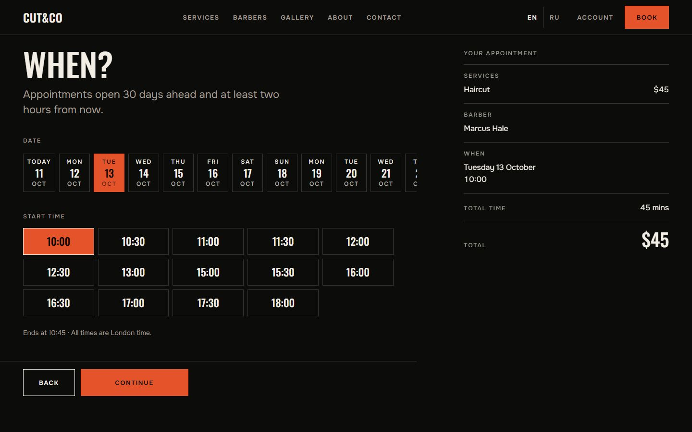
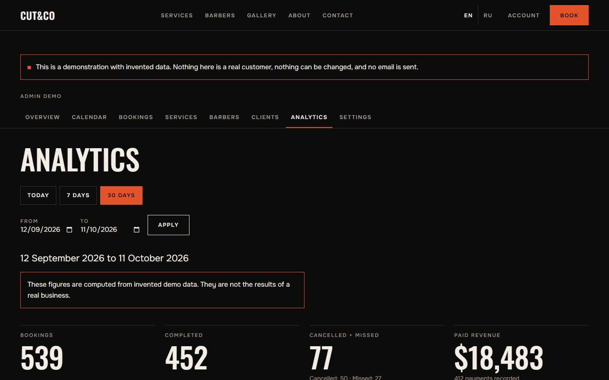
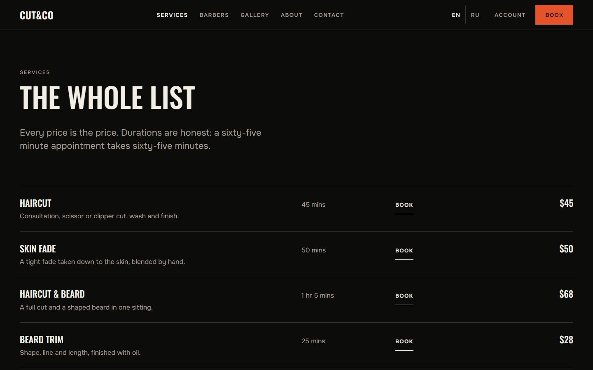
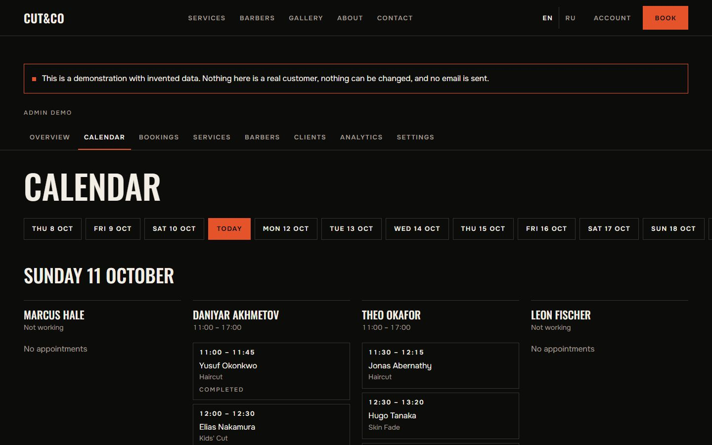

# CUT&CO

A barbershop website and booking application: public site, online booking with
email verification, client, barber and admin workspaces, and an installable
PWA. English and Russian, prices in US dollars.

**This is a concept portfolio project. CUT&CO is not a real business, and
nothing here can be booked, bought or visited.**


| | |
|---|---|
|  |  |
|  |  |

## Status

**Live: https://barbershop-demo-sable.vercel.app** — deployed with its
database and accounts. Booking emails are not configured yet (no Resend key),
so a booking made there stops at "check your email".

**All five phases are built.** In place: the
bilingual public site; real booking with email confirmation, rescheduling and
cancelling; client accounts; the barber's workspace; the admin workspace
(calendar, bookings made by staff, outcomes, payments at the counter,
services, barbers and their hours, clients, settings, analytics); a public
read-only demo of that workspace on invented data; an installable PWA with an
honest offline page; security headers; data retention and erasure.

Without a database configured the site still runs: it serves its built-in
catalog, and the booking page shows the same wizard on a mock, labelled as a
preview.

| Phase | Scope | State |
|---|---|---|
| 01 | Architecture and foundation | Done |
| 02 | Public website and booking interface | Done |
| 03 | Booking engine, email and accounts | Done |
| 04 | Admin panel, analytics and public demo | Done |
| 05 | Final QA, security and PWA | Done; deployed, email delivery pending |

**Known limits**, in full in [`docs/security.md`](docs/security.md): the
security review was a self-review, not an independent one; real email delivery
and the emails Supabase sends itself were never exercised; only Chrome was
tested, on no real phone; reminders need a scheduler the free Vercel plan does
not provide.

## Features

- **Public site** in English and Russian: front page, services, barbers,
  gallery, about, contact.
- **Booking**: several services at once, a chosen barber or any available, a
  thirty-minute grid, two hours' notice, thirty days ahead. A time is held for
  fifteen minutes and becomes a booking when the email link is confirmed.
- **Changing a booking** from the email link or the account, up to twelve
  hours before.
- **Client account**: upcoming and past bookings.
- **Barber workspace**: the day, outcomes, breaks, time-off requests.
- **Admin workspace**: calendar, bookings, catalog, hours, clients, settings,
  analytics.
- **Public demo** of the admin workspace at `/demo/admin`.
- **PWA**: installable; offline, every page is replaced by a page that says so
  and says that nothing was booked. No page is ever served from a cache.

## Technology

Next.js 16 (App Router) · TypeScript · Tailwind CSS 4 · next-intl ·
Supabase (PostgreSQL, Auth) · Zod · Vitest

## Running locally

Requires Node.js 22.12 or newer.

```bash
npm install
npm run db:dev    # in one terminal: a local PostgreSQL, no Docker, no account
npm run dev       # in another
```

Open http://localhost:3000. `npm run db:dev` creates the database with the
migrations and the seed applied and writes `.env.local` on its first run.
Skip it and the site still runs, with the booking page in preview mode.

Emails are not sent in development. They are written to `.tmp/mail` and shown
at http://localhost:3000/en/dev/mail, with their links: book an appointment,
open that page, and follow the confirmation link. `npm run jobs` sends whatever
is due on the queue, the way the scheduler does in production.

## Scripts

| Command | Purpose |
|---|---|
| `npm run dev` | Development server |
| `npm run build` | Production build |
| `npm run start` | Serve the production build |
| `npm run lint` | ESLint |
| `npm run typecheck` | TypeScript check |
| `npm run db:dev` | Local PostgreSQL for development (`-- --reset` to start over) |
| `npm run jobs` | Run the email queue once against the local server |
| `npm run db:migrate` | Apply pending migrations to the database in `.env.local` (`-- --seed` adds the seed) |
| `npm run user:create -- <email> <role> [barber-slug] ["Name"]` | Create a staff or demo account |
| `npm test` | Unit tests and database tests |
| `npm run images -- <folder>` | Rebuild `public/images` from the raw photographs |

The database tests start a real PostgreSQL from the `embedded-postgres`
package (no Docker), apply the migrations and the seed, and run against it.

## Database

`supabase/migrations` holds the schema and the row level security policies;
`supabase/seed.sql` holds the fictional shop: four barbers, eight services,
their weekly hours. To set up a Supabase project, run the migration files in
name order and then the seed in the SQL editor, or link the project and use
the Supabase CLI:

```bash
npx supabase link --project-ref <ref>
npx supabase db push
```

### Accounts

Sign-in is by email and password, through Supabase Auth. Signing up on the
site always creates a client; the address must be confirmed from an email that
Supabase sends. In the Supabase dashboard, under Authentication -> URL
Configuration, add the site's address followed by `/**` to the redirect URLs
(for local work: `http://localhost:3000/**`), or the links in those emails
will not come back to the right page.

Staff accounts are made from the command line, by someone who holds the
database connection string:

```bash
npm run user:create -- marcus@example.com barber marcus-hale "Marcus Hale"
npm run user:create -- owner@example.com admin
```

The password is generated and printed once. The local database from
`npm run db:dev` has no Supabase Auth: accounts need a real Supabase project.

### Admin and demo

`/admin` is the admin workspace, for accounts with the admin role only.
`/demo/admin` shows the same pages to anyone, read-only, on invented data that
is built in memory: it reads no database, shows no real person, has no form
that changes anything and sends no email. Every page of it says it is a demo.

The application reaches the database directly, with `DATABASE_URL`, for
everything to do with bookings. See `.env.example` for every variable.

### Scheduler

`GET /api/cron/notifications` with `Authorization: Bearer <CRON_SECRET>` sends
the emails that are due, expires stale holds and clears out stale personal
data (`docs/security.md`). Reminders need it to run every
few minutes. Vercel's free plan runs cron jobs once a day at most, so on that
plan the call has to come from elsewhere: Supabase `pg_cron` with `pg_net`, or
any external scheduler. Emails caused by an action (verification, confirmation,
cancellation) do not wait for it: they are sent right after the action.

## Email

Booking emails go through [Resend](https://resend.com). Set `RESEND_API_KEY`
and `EMAIL_FROM` (an address on a domain verified in Resend). Turn click
tracking off for the domain: the links carry their token after a `#`, and a
tracking redirect is one more thing that has to pass it through. Without a
key, in development, emails are written to `.tmp/mail`; in production they
fail and stay queued. To serve a production build locally with the mail sink:
`EMAIL_SINK=1 npm run start`.

Sign-up and password-reset emails are sent by Supabase Auth, not by the
application; their templates and sender are set in the Supabase dashboard.

## Deployment (Vercel and Supabase)

The live site has steps 1, 2, 4 and 6 done; Resend and the scheduler are not
set up. The full list:

1. **Supabase.** Create a project. Apply the migrations and the seed:
   put the pooler connection string in `.env.local` as `DATABASE_URL` and run
   `npm run db:migrate -- --seed`.
2. **Supabase Auth.** Authentication → URL Configuration: set the site URL to
   the production address and add `<address>/**` to the redirect URLs.
3. **Resend.** Verify a sending domain, create an API key.
4. **Vercel.** Import the project with `barbershop-demo` as the root directory
   (framework preset: Next.js). Set the environment variables from
   `.env.example`: `DATABASE_URL`, `APP_URL` (the production address),
   `SESSION_SECRET`, `CRON_SECRET`, `RESEND_API_KEY`, `EMAIL_FROM`,
   `NEXT_PUBLIC_SUPABASE_URL`, `NEXT_PUBLIC_SUPABASE_PUBLISHABLE_KEY`, and
   `DATABASE_CA_CERT` to verify the database certificate. Never put a secret
   in a variable whose name starts with `NEXT_PUBLIC_`.
5. **Scheduler.** Call `/api/cron/notifications` every five minutes with the
   bearer token, from Supabase `pg_cron` + `pg_net` or an external scheduler.
6. **Staff.** `npm run user:create -- owner@example.com admin`, then one per
   barber.
7. **Check.** Book as a guest, confirm from the email, move it, cancel it;
   sign up; sign in as the admin; install the site on a phone and open it
   with the network off.

## Structure

```
app/            Routes; everything user-facing is under [locale]
components/     Shared components
i18n/           Locale routing and navigation helpers
lib/            Configuration, formatting, environment, Supabase clients
messages/       Interface text: en.json and ru.json
supabase/       Migrations and seed
tests/          Database tests and catalog checks
data/           Image registry
scripts/        Image processing, icons, migrations, accounts
docs/           Brief, architecture, design system, security review, screenshots
```

- [`docs/architecture.md`](docs/architecture.md) — data model, concurrency
  strategy, permission matrix, security review.
- [`docs/security.md`](docs/security.md) — the final review: findings, fixes,
  personal data, what was not verified.
- [`docs/case-study.md`](docs/case-study.md) — outline of the portfolio write-up.
- [`docs/design-system.md`](docs/design-system.md) — colour, type, layout.
- [`docs/image-brief.md`](docs/image-brief.md) — the photographs the site needs.

## Photographs

The photographs are generated for the project and supplied separately
(`docs/image-brief.md`). Until one is supplied, its place shows an empty frame
with a caption. `npm run images -- <folder>` processes whatever is in the
folder and can be run again as more arrive.
