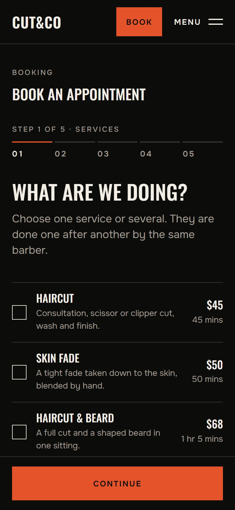

# CUT&CO

A barbershop website with real online booking: a public bilingual site, a
booking flow with email confirmation, client accounts, a barber's workspace,
an admin workspace with analytics, and an installable PWA. English and
Russian, prices in US dollars.

**Concept project.** CUT&CO is not a real business; nothing here can be
booked, bought or visited.

**Live demo:** https://barbershop-demo-sable.vercel.app (admin workspace demo:
[`/en/demo/admin`](https://barbershop-demo-sable.vercel.app/en/demo/admin)).
The live site currently runs **without a database** (see Status), so booking
there is a labelled preview.


## Who it is for and what it solves

A small service business that books by the hour. Booking looks simple and is
not: two people must never get the same barber at the same time, a held slot
must free itself if nobody confirms, a client must be able to move or cancel
without an account, and staff must see only what their role allows. CUT&CO
handles these in the database, not just in the interface.

## Features

- **Public site** in English and Russian: front page, services, barbers,
  gallery, about, contact.
- **Booking**: several services at once, a chosen barber or "any available",
  a 30-minute grid, two hours' notice, up to 30 days ahead. A time is held for
  15 minutes and becomes a booking when the email link is confirmed.
- **Changing a booking** from the email link or the account, up to 12 hours
  before; rescheduling secures the new time before releasing the old one.
- **Client account**: upcoming and past bookings.
- **Barber workspace**: the day, visit outcomes, breaks, time-off requests.
- **Admin workspace**: calendar, bookings made by staff, payments taken at the
  counter, services, barbers and their hours, clients, settings, analytics
  (revenue from recorded payments, utilisation with a stated method).
- **Public demo** of the admin workspace on invented data. It reads no
  database, sends no email and has no form that changes anything.
- **Emails** queued with idempotency keys: verification, confirmation, and
  reminders 24 and 2 hours before.
- **PWA**: installable; offline, every page is replaced by a page that says so.
- **Privacy**: retention and erasure of personal data, security headers,
  email tokens stored only as hashes.

| | |
|---|---|
|  |  |
|  |  |

<p>
  
  
</p>

## Technology and architecture

Next.js 16 (App Router) · React 19 · TypeScript · Tailwind CSS 4 · next-intl ·
Supabase (PostgreSQL, Auth) · node-postgres · Zod · Vitest

- **The database enforces the booking rules.** Booking, confirming and
  rescheduling are PostgreSQL functions that take a per-barber lock; an
  exclusion constraint makes overlapping confirmed bookings impossible.
  Expired holds stop blocking by timestamp, even if cleanup is late.
- **Two layers of authorisation**: role checks in server code and row level
  security in the database. Prices, durations and roles are never taken from
  the browser.
- **One admin interface, two sources**: the real workspace reads PostgreSQL;
  the demo builds invented data in memory from the date.
- Money is stored as integer cents; times in Europe/London, safe across
  daylight-saving changes.

Details: [`docs/architecture.md`](docs/architecture.md).

## Running locally

Requires Node.js 22.12 or newer. No Docker or cloud account is needed.

```bash
npm install
npm run db:dev    # terminal 1: a local PostgreSQL with migrations and seed
npm run dev       # terminal 2
```

Open http://localhost:3000. `npm run db:dev` writes `.env.local` on its first
run. Without it the site still runs, with booking in preview mode.

Emails are not sent in development: they are written to `.tmp/mail` and shown
at http://localhost:3000/en/dev/mail with their links. `npm run jobs` sends
whatever is due on the queue, as the scheduler does in production.

## Environment variables

Copy `.env.example` to `.env.local`. Placeholders only; never commit real
values. Nothing secret may have a `NEXT_PUBLIC_` name.

| Variable | Purpose | Secret |
|---|---|---|
| `DATABASE_URL` | PostgreSQL connection string (Supabase transaction pooler) | Yes |
| `DATABASE_CA_CERT` | Optional: verify the database certificate | No |
| `APP_URL` | The site's public address, used in email links | No |
| `SESSION_SECRET` | Signs short-lived management sessions | Yes |
| `CRON_SECRET` | Bearer token for the scheduled job | Yes |
| `RESEND_API_KEY` | Transactional email (Resend) | Yes |
| `EMAIL_FROM` | Sender address on a verified domain | No |
| `NEXT_PUBLIC_SUPABASE_URL` | Supabase project URL (Auth) | No |
| `NEXT_PUBLIC_SUPABASE_PUBLISHABLE_KEY` | Supabase publishable key | No |

## Testing

```bash
npm run typecheck
npm run lint
npm test          # 248 unit and database tests on a real PostgreSQL
npm run build
```

The database tests start PostgreSQL from the `embedded-postgres` package, apply
the migrations and seed, and test racing bookings, hold expiry, late
confirmation, the cancellation boundary, daylight-saving days, role bypass
attempts and payment reporting.

## Deployment (Vercel and Supabase)

1. Create a Supabase project; put the pooler connection string in
   `.env.local` and run `npm run db:migrate -- --seed`.
2. Supabase Auth -> URL Configuration: set the site URL and add `<address>/**`
   to the redirect URLs.
3. Resend: verify a sending domain, create an API key, turn click tracking off.
4. Vercel: import the project with `barbershop-demo` as the root directory and
   set the variables above.
5. Scheduler: call `GET /api/cron/notifications` with
   `Authorization: Bearer <CRON_SECRET>` every few minutes (Vercel's free plan
   runs cron once a day, so use Supabase `pg_cron` or an external scheduler).
6. Staff accounts: `npm run user:create -- <email> admin`, then one per barber
   (`<email> barber <barber-slug> "<Name>"`).

## Status and limitations

- **All planned features are built and tested.** The site was deployed with a
  database; since 2026-10-12 the Supabase project is paused to free a
  free-tier slot, so the live site runs on its built-in catalogue: booking is
  a labelled preview, accounts are not available, the admin demo works. To
  restore: resume the project, set `DATABASE_URL` and the two Supabase keys,
  redeploy.
- Real email delivery through Resend was never exercised (no account
  configured); reminders need an external scheduler on the free plan.
- The security review is a self-review, not an independent audit
  ([`docs/security.md`](docs/security.md)).
- Tested in Chrome only, not on real phones.

## Documents

- [`docs/requirements.md`](docs/requirements.md): product requirements
- [`docs/architecture.md`](docs/architecture.md): data model, concurrency,
  permission matrix
- [`docs/security.md`](docs/security.md): security review, personal data,
  what was not verified
- [`docs/design-system.md`](docs/design-system.md): colour, type, layout
- [`docs/case-study.md`](docs/case-study.md): outline of the case study

Photographs were generated for the project and processed with
`npm run images -- <folder>`; until one is supplied, its place shows an empty
frame with a caption.
