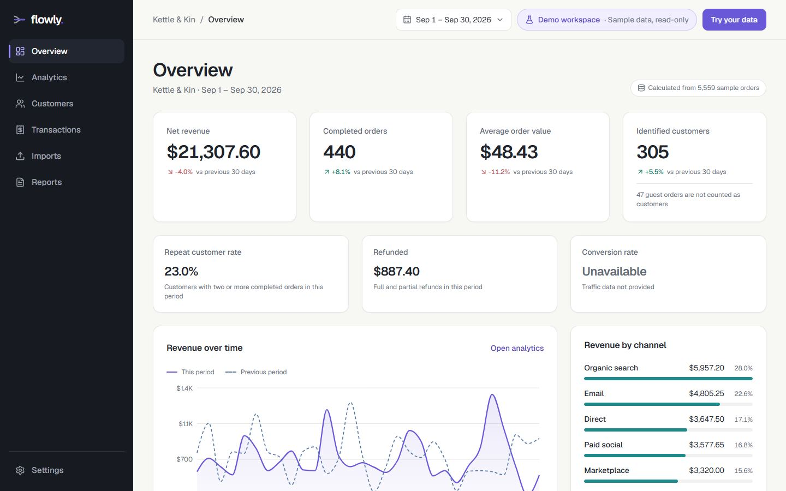
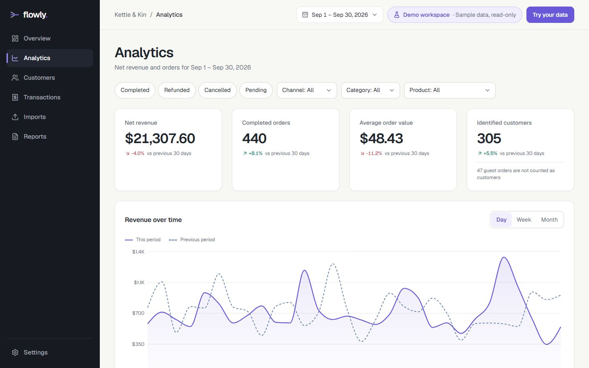
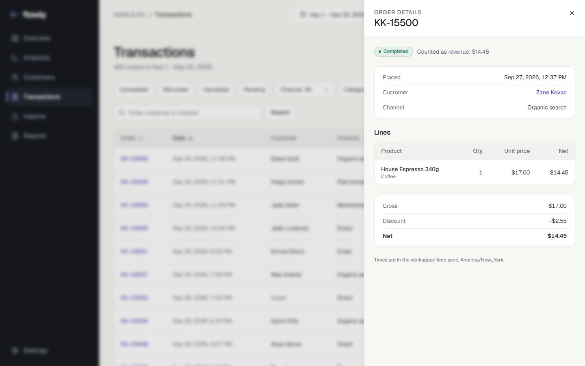
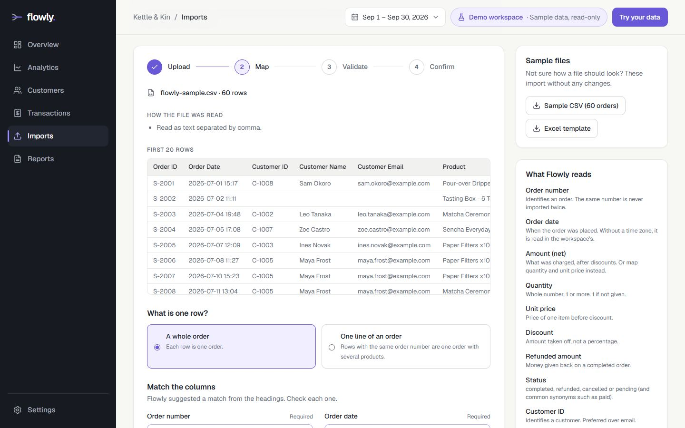
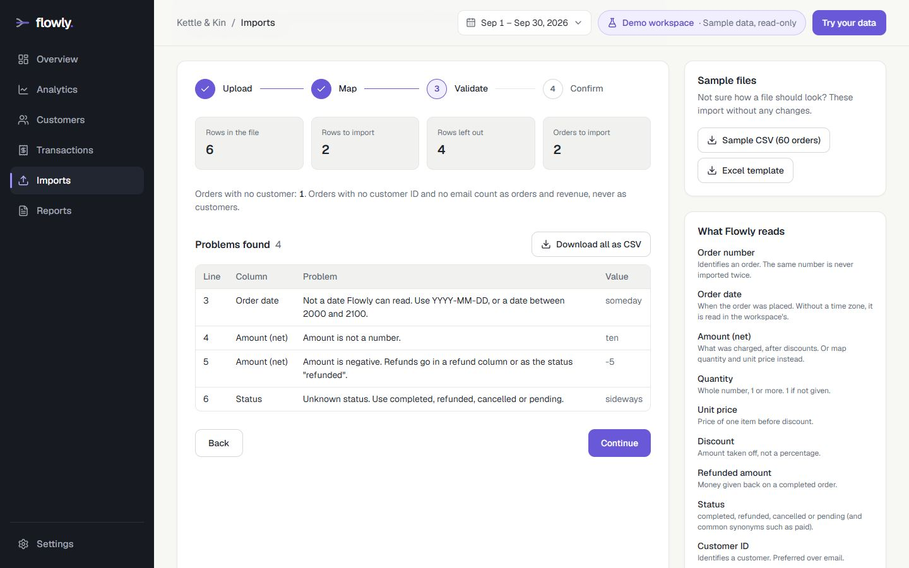
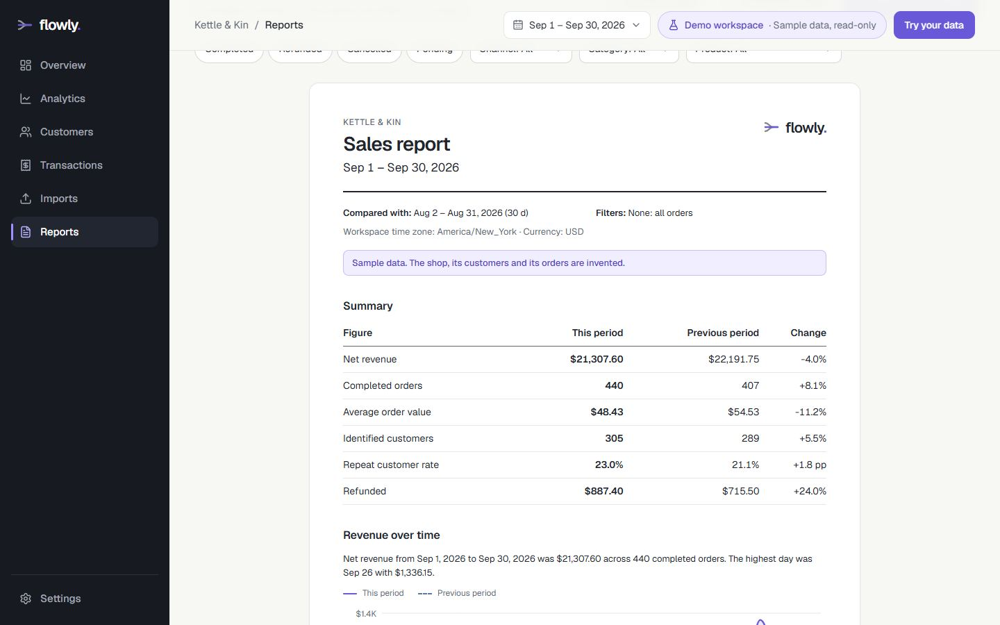
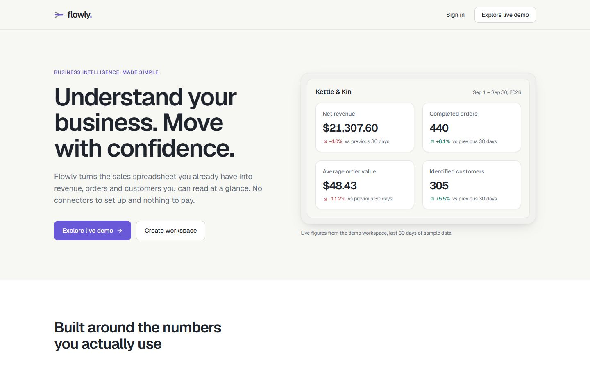
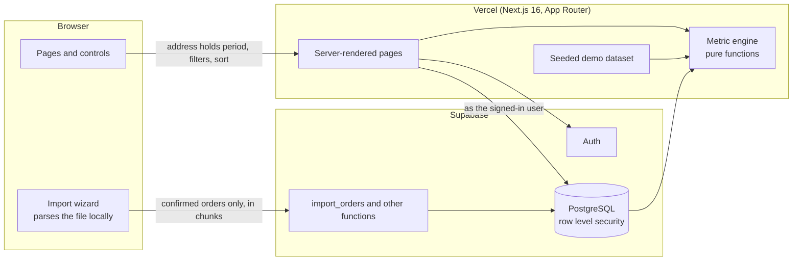

# Flowly

Business intelligence for small businesses: explore a full demo without an
account, or sign up and turn a CSV or Excel export of your orders into
revenue, customers and reports. Built on free tiers only.

**Live demo:** https://flowly-nine-ochre.vercel.app (the demo workspace, no
account needed: [`/demo`](https://flowly-nine-ochre.vercel.app/demo)).

**Concept project.** Flowly is not a company. The sample shop, its customers
and its orders are invented.



|                                                              |                                                                        |
| ------------------------------------------------------------ | ---------------------------------------------------------------------- |
|      |                       |
|  |  |
|          |                           |

## Who it is for and what it solves

Small shops and independent operators who sell online but have no analyst:
their order history sits in a CSV or Excel export from their store. Flowly
turns that file into revenue, customers, trends and a printable report, with
every figure defined and consistent across pages. The file is read in the
browser and never uploaded as a whole.

## Status

**Complete and deployed.** Accounts, imports, reports and settings work
against a live Supabase project; the demo needs no backend. What was verified
and what was not is stated below and in [`docs/security.md`](docs/security.md).

On the public deployment the Supabase project is currently paused (checked
2026-10-27): the demo works, sign-in and accounts do not until the project is
resumed.

## Features

| Area         | What it does                                                                                                                                                              |
| ------------ | ------------------------------------------------------------------------------------------------------------------------------------------------------------------------- |
| Demo         | A whole workspace on 5,559 seeded orders, no account, no backend. Read-only. Every figure on every page is calculated from the same orders                                |
| Period       | Seven ready-made periods or any range; every figure compared with the same number of days before                                                                          |
| Filters      | Status, channel, category, product: the same on every page, carried from page to page, kept in the address                                                                |
| Overview     | Net revenue, completed orders, average order value, identified customers, repeat rate, refunds, revenue trend, channels, top products, recent orders                      |
| Analytics    | Revenue by day, week or month; breakdown by channel, category or product; the chart's numbers as a table                                                                  |
| Customers    | Who bought in the period, spend then and in all, new or returning, full order history. Orders that name nobody are never shown as people                                  |
| Transactions | Every order, searchable, sortable, paged, with its lines                                                                                                                  |
| Imports      | CSV and XLSX, read in the browser: match columns, see every row that will be left out and why, choose what to do with duplicates, confirm. Sample files. Delete an import |
| Reports      | A printable A4 report with methodology footnotes; PDF through the browser's print window; CSV                                                                             |
| Settings     | Workspace name, currency, time zone; password; delete all data; delete the account                                                                                        |
| Accounts     | Email and password through Supabase Auth; one private workspace per account                                                                                               |
| Downloads    | CSV of exactly what is on screen, with spreadsheet-formula injection neutralised                                                                                          |
| Themes       | Light and dark (greys and near-black), or the device's own setting; remembered in the browser; a printed report is always light                                           |

Deliberately absent, as the requirements say: payments, live integrations,
teams, billing, a conversion rate (there is no traffic data, and none is
invented).

## Architecture



- **One engine, two sources.** Every figure comes from pure functions in
  `lib/metrics` applied to a `Dataset`. The demo generates its dataset from a
  fixed seed; a signed-in workspace reads its own from the database. The
  pages cannot tell which they are showing, so two pages cannot disagree.
- **State lives in the address.** Period, filters, sort, page and open drawer
  are search parameters, validated on the server. Any view can be linked to.
- **Files never leave the browser.** The wizard parses and validates locally;
  only confirmed orders are sent, and the database checks each one again.
- **The database is the boundary.** Row level security on every table; no
  service-role key anywhere.

More in [`docs/requirements.md`](docs/requirements.md), [`docs/architecture.md`](docs/architecture.md),
[`docs/metrics.md`](docs/metrics.md) and
[`docs/design-system.md`](docs/design-system.md).

## Running locally

Requires Node.js 22.12 or newer. No environment variables are needed for the
demo.

```bash
npm install
npm run dev
```

Open http://localhost:3000. Without Supabase configured, the account pages say
that accounts are not set up; everything else works.

## Accounts and your own data (Supabase)

1. Create a Supabase project (free tier).
2. Authentication → Sign In / Providers → Email: switch **Confirm email** off.
   An account then works as soon as it is made. (With it on, sign-up asks the
   user to confirm first, and Supabase's built-in mailer sends only a few
   emails an hour.)
3. Authentication → URL Configuration: set the site URL and add the site's
   address followed by `/**` to the redirect URLs (locally:
   `http://localhost:3000/**`), for password-reset links.
4. Copy `.env.example` to `.env.local` and fill in:

   | Variable                               | What                                                        | Secret?                               |
   | -------------------------------------- | ----------------------------------------------------------- | ------------------------------------- |
   | `NEXT_PUBLIC_SUPABASE_URL`             | Project URL, e.g. `https://abc.supabase.co` (no path)       | No                                    |
   | `NEXT_PUBLIC_SUPABASE_PUBLISHABLE_KEY` | The publishable key. **Never a secret or service-role key** | No                                    |
   | `DATABASE_URL`                         | Transaction pooler connection string, for `db:migrate` only | **Yes.** Never deployed, never public |

5. Apply the migrations: `npm run db:migrate` (or paste the files of
   `supabase/migrations` into the SQL editor in name order).
6. `npm run dev`, open `/signup`.

## Data dictionary

| Table            | Row                         | Columns that matter                                                                                                                                                                              |
| ---------------- | --------------------------- | ------------------------------------------------------------------------------------------------------------------------------------------------------------------------------------------------ |
| `workspaces`     | One per account             | `owner_user_id`, `name`, `currency_code`, `timezone`                                                                                                                                             |
| `import_batches` | One per imported file       | `filename`, `file_type`, `interpretation` (order or line per row), `row_count`, `accepted_count`, `rejected_count`, `status`, `mapping_json`, `warnings_json`                                    |
| `customers`      | One per identified person   | `identity_key` (`id:<customer id>` or `email:<email>`), `external_customer_id`, `name`, `email`                                                                                                  |
| `orders`         | One per order number        | `external_order_id` (unique per workspace), `order_date` (UTC), `customer_id` (nullable), `channel`, `status`, `gross_amount`, `discount_amount`, `net_amount`, `refund_amount`, `currency_code` |
| `order_lines`    | One per product on an order | `position`, `product_name`, `category`, `quantity`, `unit_price`, `gross_amount`, `discount_amount`, `net_amount`                                                                                |

Amounts are `numeric`; instants are `timestamptz`. An order is always the sum
of its lines and always in its workspace's currency; the database enforces
both. What each figure means: [`docs/metrics.md`](docs/metrics.md).

## Scripts

| Command                            | Purpose                                                                      |
| ---------------------------------- | ---------------------------------------------------------------------------- |
| `npm run dev`                      | Development server                                                           |
| `npm run build` / `npm run start`  | Production build and server                                                  |
| `npm run typecheck`                | TypeScript                                                                   |
| `npm run lint`                     | ESLint                                                                       |
| `npm run format` / `format:check`  | Prettier                                                                     |
| `npm test`                         | Unit and database tests (Vitest; starts a real PostgreSQL, no Docker needed) |
| `npm run test:e2e`                 | End-to-end tests (Playwright; builds first, uses the installed Chrome)       |
| `CROSS_BROWSER=1 npm run test:e2e` | The same in Firefox, WebKit and an emulated iPhone as well                   |
| `npm run db:migrate`               | Apply `supabase/migrations` to the database in `DATABASE_URL`                |
| `npm run samples`                  | Regenerate the sample CSV and the Excel template                             |

## How it was verified

- **194 unit and database tests.** Metric definitions against a week worked
  out by hand; sums that must agree (chart buckets, breakdown rows and
  customers' spend all add up to net revenue); time zones and daylight saving;
  money parsing; the import pipeline; and, on a real PostgreSQL, that one
  account cannot read, change, delete or add to another's data through any
  table or function.
- **End-to-end tests** in Chrome on desktop and phone, and the same suite in
  Firefox, WebKit and an emulated iPhone.
- **A structural accessibility sweep** of 14 pages at three widths in Chrome,
  Firefox and WebKit: headings, names, labels, ids, landmarks, target sizes,
  no horizontal scrolling.
- **The whole private path against the live project and the deployed site**,
  43 checks in a real browser: setting up a workspace, importing, figures to
  the cent, downloads, re-importing, signing out and in, a second account
  seeing nothing of the first's through the pages or the API, settings,
  deleting an import, all data, and the account.

## Known limits

- **The security review was a self-review**, not an independent audit.
- **The reset email was not followed end to end.** Sign-up through the site,
  changing a password and the reset form's answer were checked on the deployed
  site; receiving the email and opening its link needs a real inbox and was
  left to a manual try.
- **Not tested on physical phones or real Safari**; WebKit and device
  emulation stand in for them.
- **The PDF** was checked for format and page size, not read by eye.
- **A workspace is loaded whole** for every page view, which keeps every
  figure consistent and bounds a workspace at 50,000 orders.
- **No rate limiting of its own**; Supabase limits sign-in attempts.

### Free-tier caveats

- **Supabase Free**: about 500 MB of database, two projects, and a project is
  paused after roughly a week without use (the demo does not depend on it).
  No backups to rely on.
- **Vercel Hobby**: for personal, non-commercial use, with its own request and
  build limits.
- Limits change; check the providers' pages. Flowly promises no uptime.

## Hosting

Deployed to Vercel from this folder (`npx vercel deploy --prod`), with the two
public Supabase variables set in the project. The requirements named Cloudflare
Workers; Vercel was chosen instead, so no adapter is involved and the adapter
comparison was not run.

## Third-party software

All MIT unless noted: Next.js, React, Tailwind CSS, shadcn/ui components
(copied in) on Base UI, Lucide (ISC), Recharts, Papa Parse, read-excel-file,
write-excel-file, Supabase JS, decimal.js, Zod, class-variance-authority
(Apache-2.0), Geist typeface (SIL OFL). No paid services, assets or licences.

## Author

Built by Evgeniy, Full-Stack Web Developer: implementing application functionality, integrating
frontend and backend components, and testing the resulting software. Contact:
[Telegram @Maybemol](https://t.me/Maybemol) · [evgeniyshade@gmail.com](mailto:evgeniyshade@gmail.com) ·
[GitHub](https://github.com/22504105). Other projects: [portfolio overview](../showcase/README.md).
