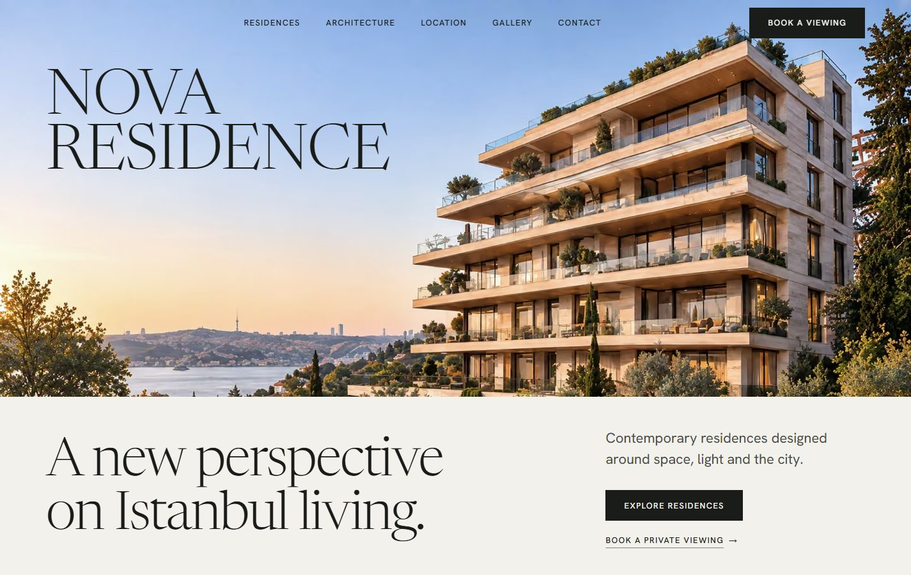
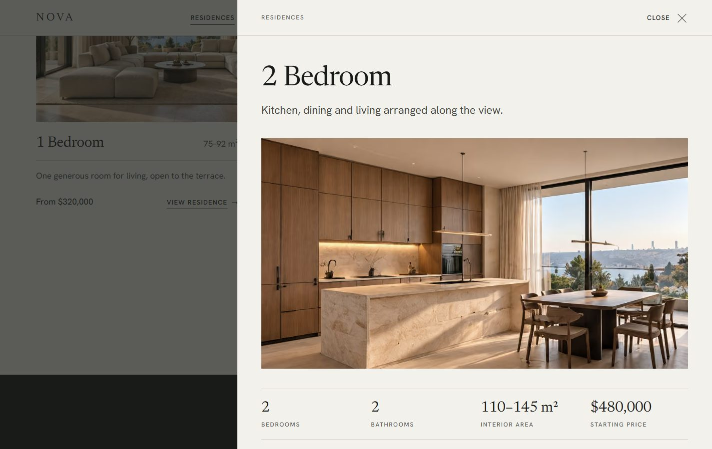
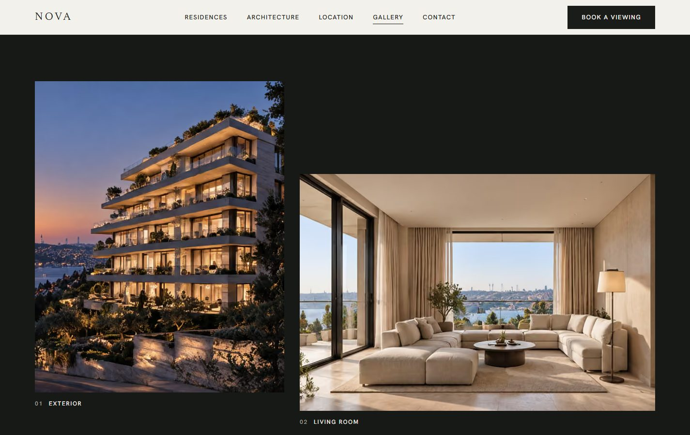
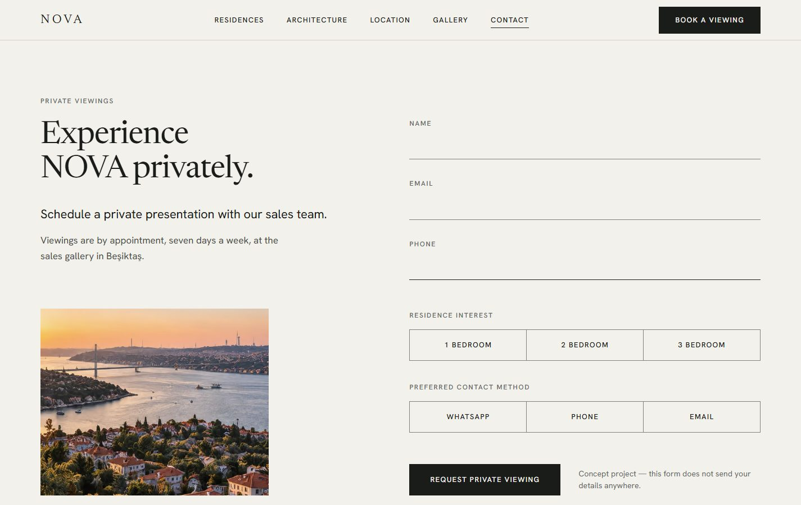
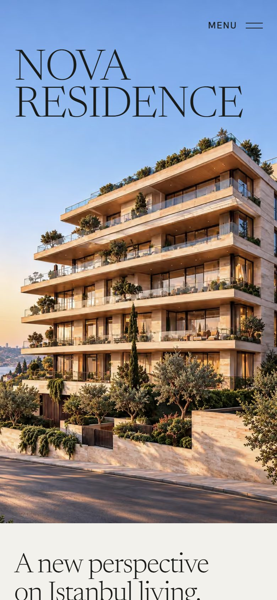
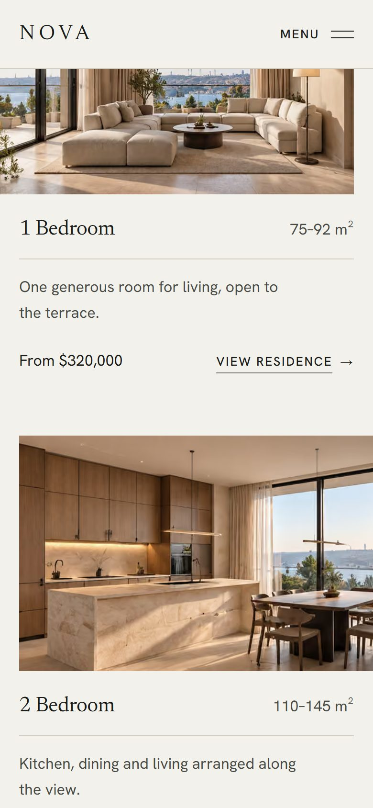

# NOVA Residence

A marketing website for a fictional premium residential development in
Istanbul: one page that presents the building, its residences and the
neighbourhood, and leads the visitor to a single action, requesting a private
viewing.

**Concept project.** NOVA Residence does not exist; it is not affiliated with
any real development. Names, prices, figures and imagery are invented.

**Live demo:** https://nova-residence-five.vercel.app



## Who it is for and what it solves

The kind of site a studio builds for a property developer: buyers and investors
should understand the project quickly, browse the residences, and book a
viewing without friction. The design carries the brand through typography,
spacing and photography rather than decoration, and the page has to stay fast
and usable on a phone.

## Features

- Hero with the wordmark set on the photograph's sky, with separate crops for
  landscape and portrait screens
- Residences with a detail drawer: photograph, facts, description and a floor
  plan drawn from data
- Editorial gallery with a full-screen lightbox: keyboard, swipe and a counter
- Stylised location map with travel times
- Viewing request form with validation, a submitting state and a success state
  (the request is simulated: nothing is sent)
- Fixed header with the current section marked, full-screen mobile menu
- Scroll reveals and light parallax that switch off with `prefers-reduced-motion`
- Keyboard accessible: native dialogs, managed focus, visible focus states

## Screenshots

| | |
|---|---|
|  |  |
|  | |

<p>
  
  
</p>

## Technology

Next.js 16 (App Router) · React 19 · TypeScript · Tailwind CSS 4 · Motion

No UI kit, icon library or backend. The page is statically prerendered. All
copy, facts and floor plans live in `data/`, so content changes do not touch
components.

```
app/          Layout, global styles and tokens, fonts, page
components/   layout/ (header, navigation, footer), sections/ (one file per
              section, plus their dialogs), ui/ (shared primitives)
data/         Copy, facts, floor plans, image registry
lib/          Small helpers and motion constants
public/images Photography, grouped by section
docs/         Requirements, design system, screenshots
```

## Running locally

Requires Node.js 20.9 or newer. No environment variables are needed.

```bash
npm install
npm run dev
```

Open http://localhost:3000.

| Command | Purpose |
|---|---|
| `npm run dev` | Development server |
| `npm run build` / `npm run start` | Production build and server |
| `npm run lint` | ESLint |
| `npm run typecheck` | TypeScript check |
| `npm run images -- <folder>` | Rebuild `public/images` from source renders |

## Testing and deployment

There is no automated test suite: the site has no logic beyond presentation.
Quality is checked with `npm run typecheck`, `npm run lint`, `npm run build`
and visual review at desktop and phone widths.

Deployed to Vercel with the default Next.js settings; when the project lives in
a subfolder of a repository, set the Vercel project's Root Directory to it.

## Status and limitations

- **Complete** as a concept site; deployed.
- The viewing form does not send or store anything.
- Photography was generated for the project and shows one consistent,
  fictional building.

## Documents

- [`docs/requirements.md`](docs/requirements.md): what the site had to do
- [`docs/design-system.md`](docs/design-system.md): colour, type, spacing, motion

## Author

Built by Evgeniy, Full-Stack Web Developer: implementing application functionality, integrating
frontend and backend components, and testing the resulting software. Contact:
[Telegram @Maybemol](https://t.me/Maybemol) · [evgeniyshade@gmail.com](mailto:evgeniyshade@gmail.com) ·
[GitHub](https://github.com/22504105). Other projects: [portfolio overview](../showcase/README.md).
