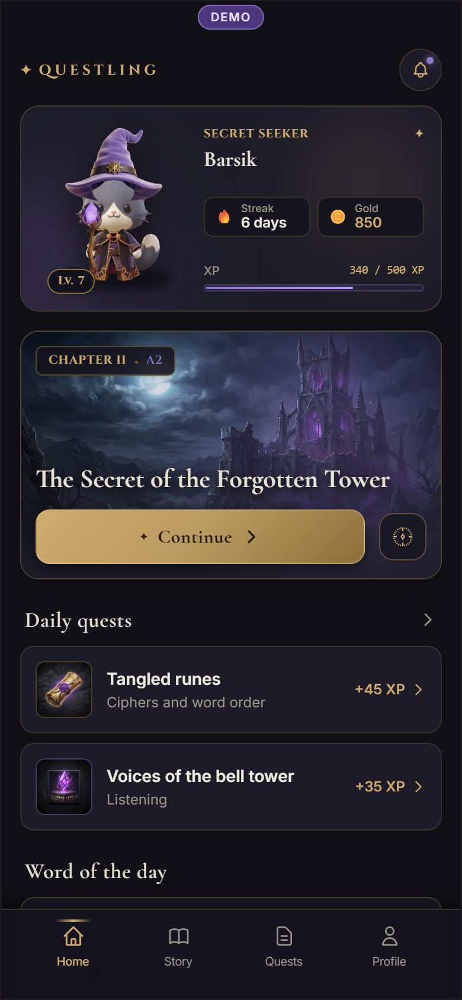
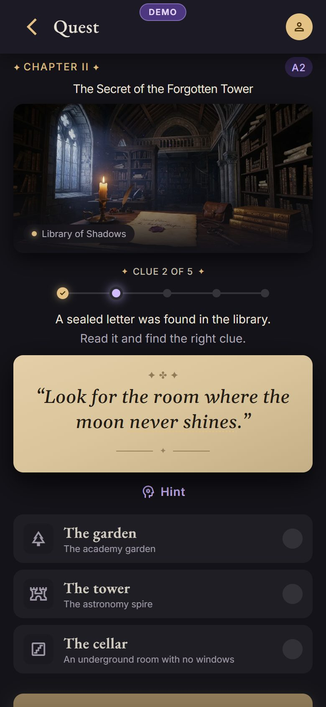
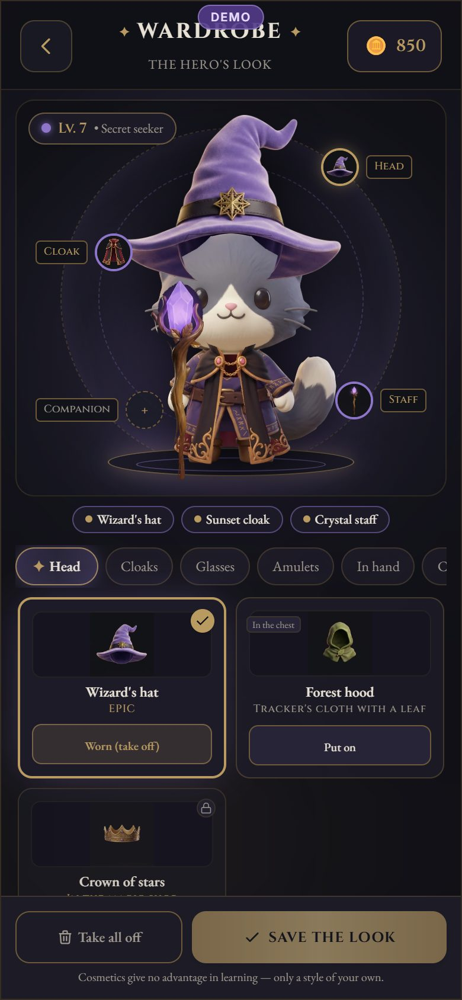
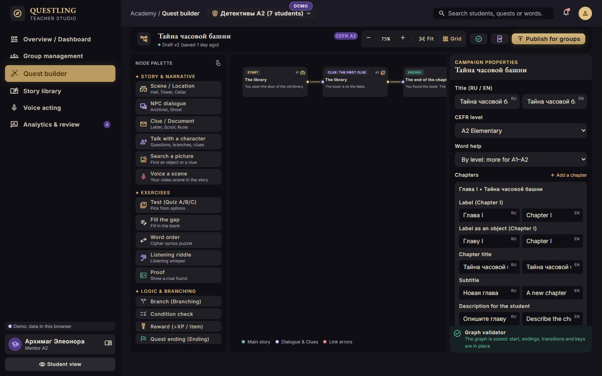
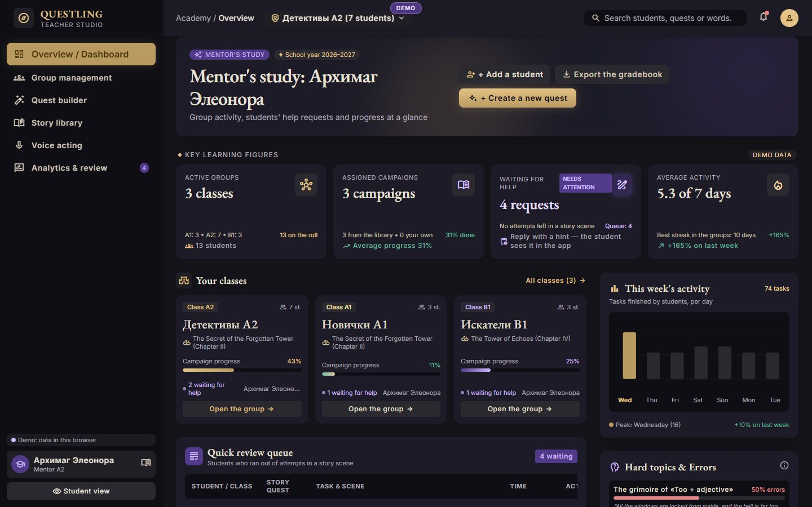
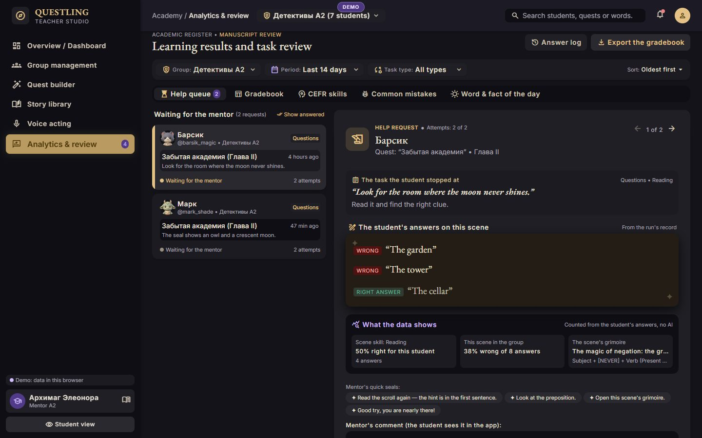
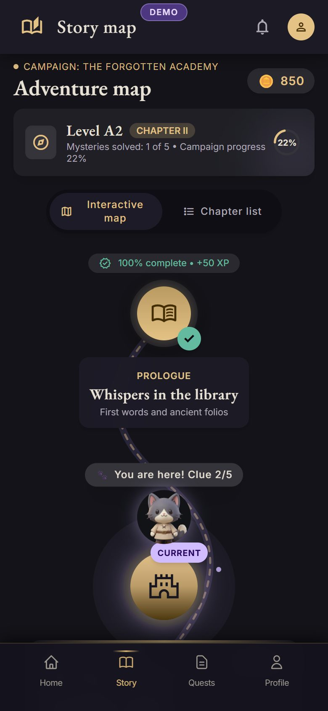
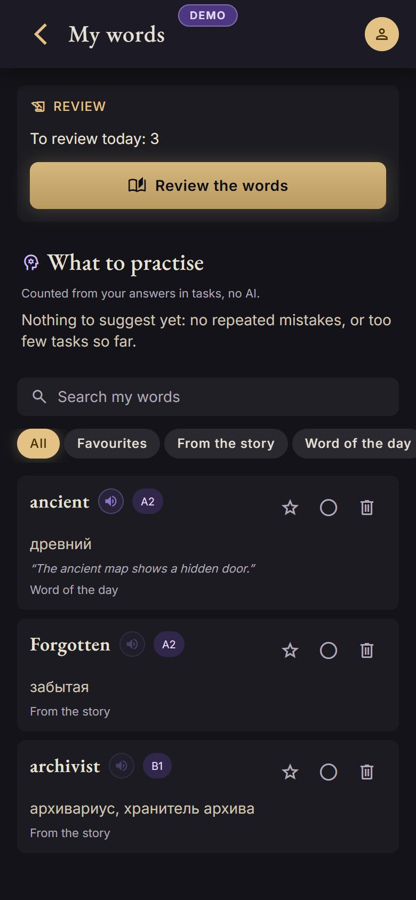
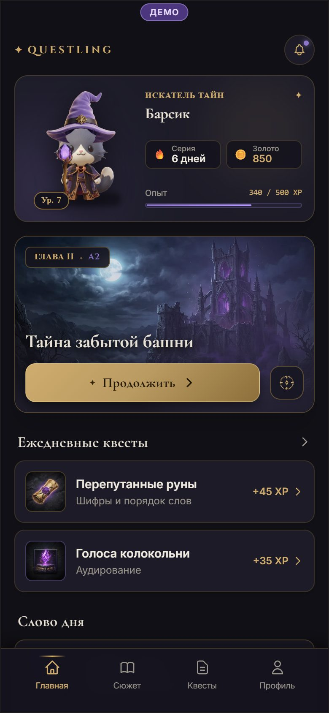

# Questling

An English-learning game in a dark-fantasy setting: a **Telegram Mini App** for
students, and a browser **Teacher Studio** where teachers run groups, build
story quests and review students' work. Russian and English interface; the
learning content is in English.

**Live demo** (invented data, no account needed):

- Student app in the browser: https://questling-dusky.vercel.app/en/demo
  ([Russian](https://questling-dusky.vercel.app/ru/demo))
- Teacher Studio demo: https://questling-dusky.vercel.app/en/demo/studio
- Inside Telegram: the bot [@QuestlingEnglish_bot](https://t.me/QuestlingEnglish_bot)

**Concept project.** Characters, campaigns and demo students are invented.

<p>
  
  
  
</p>



## Who it is for and what it solves

Teachers of English to children and teenagers (levels A1 to B2) who want
practice students actually open: inside Telegram, which they already use, as a
story with clues, choices and rewards rather than a worksheet. The teacher
keeps control: assigns content by group and level, writes their own quests,
sees where students make mistakes and answers their help requests.

## Features

**Students** (Telegram, or the browser demo)

- Six free heroes with layered equipment: 24 items drawn on every hero, bought
  with coins earned by learning (cosmetic only, no real money).
- Two original story campaigns (A1-A2 investigation, B1-B2 mystery) as
  versioned graphs with choices, puzzles, evidence and three endings each;
  progress is saved and resumed.
- Quick quests: choice, matching, fill the blank, ordering, reading, listening,
  dialogue, ciphers; daily quests and a word and fact of the day.
- Word help: tap a word for its translation, set by the teacher, without giving
  away the answer. Answer options shuffled fairly for each attempt.
- Word journal with spaced repetition and practice suggested from the
  student's own mistakes.
- Voice acting: watch a short scene, record your lines, compare with the
  original, send it to the teacher for review.
- Talks with characters and picture searches inside the story.
- XP and coins as an append-only ledger, granted once, checked on the server.
- Settings with language, and the student's own data to download or delete.

**Teachers** (email and password)

- Dashboard, groups with CEFR levels, invitations by code or Telegram link.
- Visual quest builder with validation before publishing; published versions
  stay fixed for students already playing.
- Library with publish, assign, archive; preview as a student.
- Analytics from real answers: errors by question, help queue with replies.
- Voice-acting scenes: upload a short clip, time the lines, review recordings.

|                                                                    |                                                                        |
| ------------------------------------------------------------------ | ---------------------------------------------------------------------- |
|  |  |

<p>
  
  
  
</p>

## Technology and architecture

Next.js 16 (App Router) · React 19 · strict TypeScript · Tailwind CSS 4 ·
Supabase (PostgreSQL, Auth for teachers) · Telegram Mini App APIs ·
S3-compatible storage (Backblaze B2) · Zod · Vitest · Playwright

- **Facts and actions**: a student's record is a list of facts; everything
  else is computed. Actions are pure functions shared by the demo and the
  server, so both follow the same rules. Answer keys exist only on the server.
- **Telegram identity verified on the server** (signed sign-in data); sessions
  are signed tokens sent in a header.
- **Stories as validated graphs**: every campaign is checked for reachable
  endings, valid links and provable evidence; runs are bound to a version.
- **Teachers are isolated** from one another; published versions are
  immutable (a database trigger).
- **Media in a private bucket**: the browser uploads and plays through
  short-lived signed links with the exact size signed; quotas per teacher and a
  nightly cleanup keep within the free tier.
- One set of screens for the demo and the real app: `/demo/...` keeps a demo
  student in the browser, `/app/...` talks to the server.

Details: [`docs/architecture.md`](docs/architecture.md).

## Running locally

Requires Node.js 22.12 or newer.

```bash
npm install
npm run dev            # http://localhost:3000/en/demo
```

With no settings the site is the demo, and `/app` says the server is not
connected.

## Environment variables

For the real app copy `.env.example` to `.env.local`. Placeholders only; never
commit real values.

| Variable                                                           | Purpose                                               | Secret |
| ------------------------------------------------------------------ | ----------------------------------------------------- | ------ |
| `DATABASE_URL`                                                     | Supabase PostgreSQL, transaction pooler               | Yes    |
| `TELEGRAM_BOT_TOKEN`                                               | The bot whose Mini App this is; verifies sign-in data | Yes    |
| `SESSION_SECRET`                                                   | 32+ random characters; signs sessions                 | Yes    |
| `SUPABASE_URL`, `SUPABASE_ANON_KEY`                                | Supabase Auth for teachers                            | No     |
| `MEDIA_S3_ENDPOINT`, `MEDIA_S3_REGION`, `MEDIA_S3_BUCKET`          | Media storage location                                | No     |
| `MEDIA_S3_ACCESS_KEY_ID`, `MEDIA_S3_SECRET_ACCESS_KEY`             | Media storage key, limited to one bucket              | Yes    |
| `CRON_SECRET`                                                      | Bearer token for the nightly media cleanup            | Yes    |
| `MEDIA_GLOBAL_CAP_BYTES`, `MEDIA_WARN_AT`, `MEDIA_DAILY_DOWNLOADS` | Optional storage limits                               | No     |

Then `npm run db:migrate` applies `supabase/migrations/*.sql` in order. Storage
setup: [`docs/media-storage.md`](docs/media-storage.md).

## Testing

```bash
npm run typecheck && npx eslint . && npm run format:check
npx vitest run         # 205 unit, rule and database tests (real PostgreSQL via embedded-postgres)
npx playwright test    # every screen and flow, axe accessibility, phone widths 320-430
node scripts/live-check.mjs <address>   # against a real database and bot; cleans up after itself
```

## Deployment

Vercel (region `dub1`): `npx vercel deploy --prod` from this folder, with the
variables above set in the project. Release order, staging and rollback:
[`docs/release.md`](docs/release.md).

## Status and limitations

- **Deployed** with the database, Telegram sign-in, Teacher Studio and media
  storage working; checked end to end against the live site.
- **Not yet tested on physical phones** inside Telegram, including voice
  recording on iPhone and Android ([`docs/telegram-checklist.md`](docs/telegram-checklist.md)).
- Teacher sign-up works without email confirmation; password-reset emails need
  an SMTP server that is not configured yet.
- No automatic pronunciation scoring: teachers review recordings.
- Team quests and 3D characters are out of scope.

Full list: [`docs/release.md`](docs/release.md#known-limitations-the-whole-product).

## Documents

| File                                                                                                     | About                                                      |
| -------------------------------------------------------------------------------------------------------- | ---------------------------------------------------------- |
| [`docs/requirements.md`](docs/requirements.md)                                                           | product requirements                                       |
| [`docs/architecture.md`](docs/architecture.md)                                                           | stack, identity, the student record, campaigns, the studio |
| [`docs/design-screen-map.md`](docs/design-screen-map.md)                                                 | every design screen and state mapped to a route            |
| [`docs/visual-qa/README.md`](docs/visual-qa/README.md)                                                   | screenshot comparison with the design, known differences   |
| [`docs/ASSET_AUDIT.md`](docs/ASSET_AUDIT.md)                                                             | images, equipment layers, what was made in Blender         |
| [`docs/audio.md`](docs/audio.md)                                                                         | recordings, playback, teachers' uploads                    |
| [`docs/media-storage.md`](docs/media-storage.md)                                                         | object storage, limits, setup, checks                      |
| [`docs/security.md`](docs/security.md)                                                                   | security review and findings                               |
| [`docs/qa-report.md`](docs/qa-report.md)                                                                 | functional QA, bugs fixed and left                         |
| [`docs/release.md`](docs/release.md)                                                                     | release, staging, rollback, limitations                    |
| [`docs/telegram-checklist.md`](docs/telegram-checklist.md)                                               | manual check on phones                                     |
| [`docs/features-audit.md`](docs/features-audit.md), [`docs/features-report.md`](docs/features-report.md) | the learning-features work, gate by gate                   |
| [`docs/3d.md`](docs/3d.md)                                                                               | an early 3D model experiment (not in the app)              |

Screens were implemented from a design made in Google Stitch; the character and
item artwork comes from that design, and four garments were re-cut in Blender
to fit the heroes.
