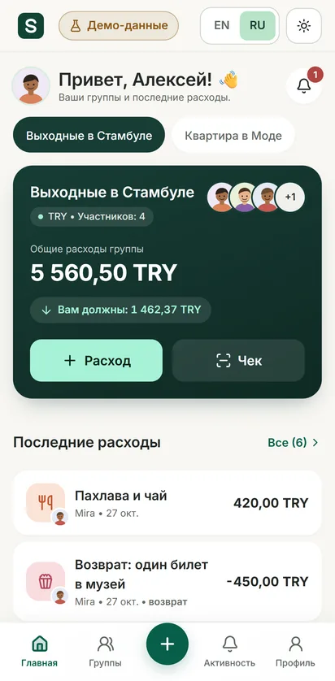
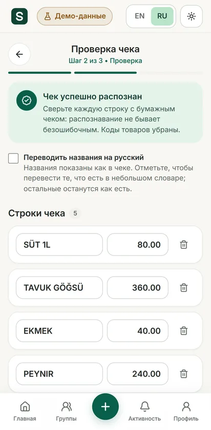
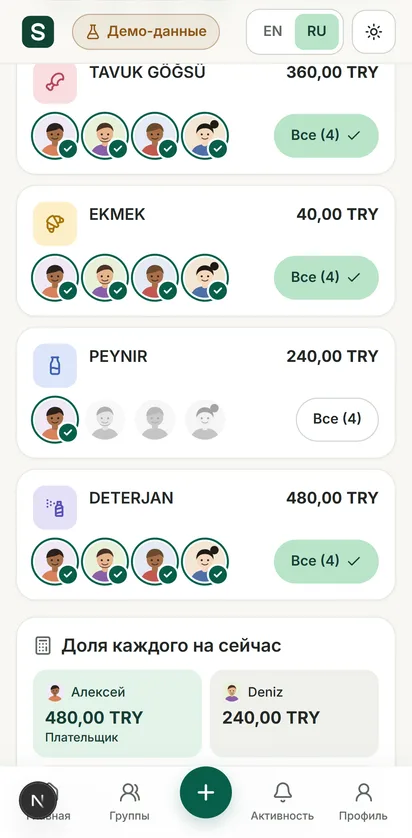
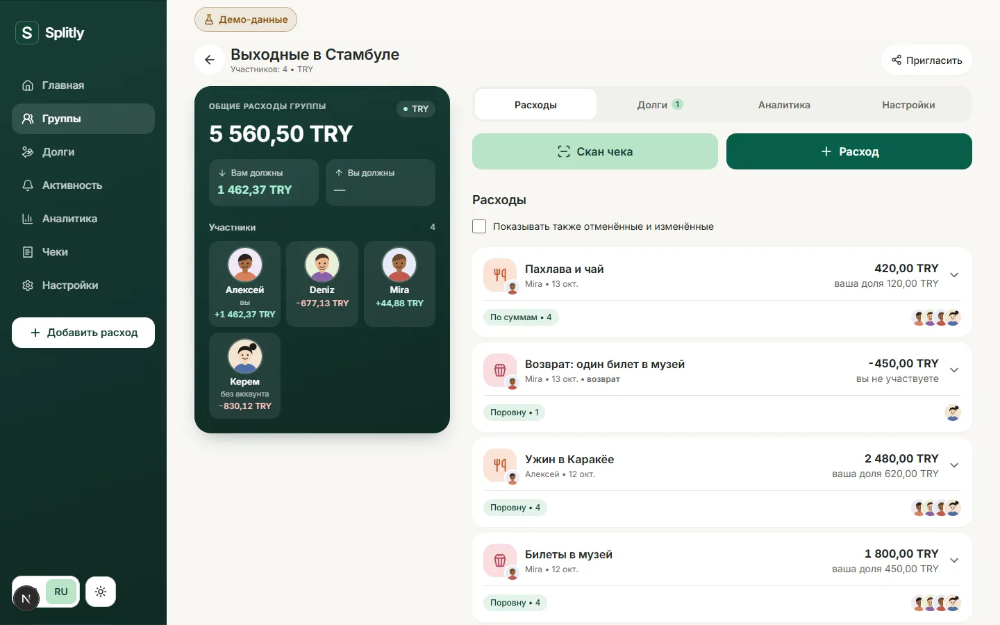
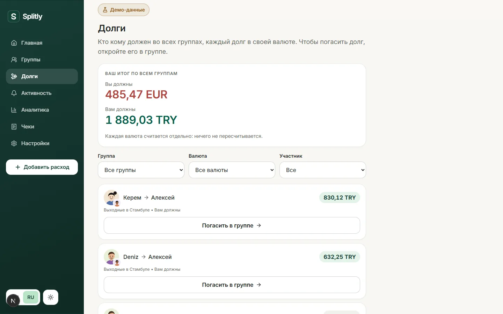
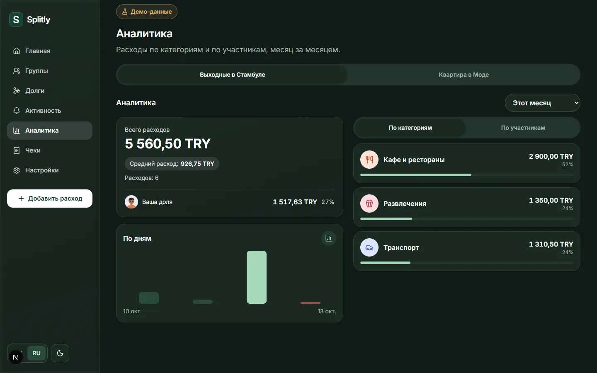

# Splitly

Shared expenses for a group of friends, flatmates or travellers: who paid, who
owes whom, and how to settle with few transfers. A Telegram Mini App with a
public browser demo, in English and Russian. Receipts are read on the device.

**Live demo:** https://splitly-self.vercel.app (browser demo with invented
data: [`/en/demo`](https://splitly-self.vercel.app/en/demo)). Inside Telegram:
the bot [@Splitlly_bot](https://t.me/Splitlly_bot).

**Concept project.** Demo names, groups and amounts are invented.

<p>
  
  
  
</p>



## Who it is for and what it solves

Groups that share costs (a trip, a flat, a dinner) and keep score in chats or
spreadsheets. Splitly lives where those groups already talk, in Telegram: no
sign-up, one tap to open. It keeps every expense in its own currency, splits
fairly to the cent, and turns a pile of debts into a short list of transfers.
A photographed receipt can be split line by line.

## Features

- **Telegram sign-in** verified on the server; no passwords.
- **Groups**: invitations by link or QR code, roles, guests without an
  account, archived groups.
- **Expenses**: equal, exact amounts or percentages; several payers;
  refunds; every change kept as a replacement, never edited in place.
- **Receipt scanner**: photo or upload, read on the device (Tesseract.js),
  review and correct lines, assign items to people. Names stay as printed;
  translation through a small built-in word list is optional.
- **Balances and settling up**: who should pay whom, per currency; payments
  recorded and confirmed. Debts are never converted between currencies.
- **Exchange rates**: entered by hand, or fetched for the day from the
  European Central Bank table on request (7 currencies). Used only to show
  totals in the group's currency.
- **Overview of all debts** across groups with filters; a ready reminder
  message to share in Telegram.
- **Analytics** by category, person and day; activity feed with unread marks.
- **Reports**: PDF, XLSX and CSV per group, and a JSON copy of all one's data.
  Inside Telegram the file is built on the server and handed over through a
  five-minute signed link.
- **Light and dark themes**, phone and wide layouts.
- **Browser demo**: the same screens and rules on invented data kept in the
  visitor's browser, with a reset.

|                                                                        |                                                                                     |
| ---------------------------------------------------------------------- | ----------------------------------------------------------------------------------- |
|  |  |

More screenshots, all from the live demo: [`docs/screenshots/stitch/`](docs/screenshots/stitch/).

## Technology and architecture

Next.js 16 (App Router) · React 19 · TypeScript · Tailwind CSS 4 · Zod ·
decimal.js · Tesseract.js · pdf-lib · PostgreSQL (Supabase) · Vitest ·
Playwright. Versions pinned exactly.

- **Money in integer minor units**, with the number of decimals taken from the
  currency (JPY has none, KWD has three). Remainders are distributed by one
  largest-remainder rule used everywhere.
- **One expense check for everything**: the form, the demo and the server use
  the same function; shares sent by the client are ignored and recomputed.
- **The database keeps the rules**: a deferred trigger ensures paid = total =
  shares for every expense; balances are never stored, always derived.
- **Sessions in a header, language in the address**: inside Telegram Web the
  app runs in a frame where cookies are unreliable.
- **Photos never leave the device**: only confirmed lines and a hash of the
  photo are sent.

Details: [`docs/architecture.md`](docs/architecture.md) and
[`docs/security.md`](docs/security.md).

## Running locally

Requires Node.js 22.12 or newer. No environment variables are needed for the
demo.

```bash
npm install
npm run dev
```

Open http://localhost:3000; the demo is at `/en/demo`.

## Environment variables

For Telegram sign-in and real data, copy `.env.example` to `.env.local`.
Placeholders only; never commit real values.

| Variable                | Purpose                                                    | Secret |
| ----------------------- | ---------------------------------------------------------- | ------ |
| `TELEGRAM_BOT_TOKEN`    | The bot's token from @BotFather; verifies sign-in data     | Yes    |
| `TELEGRAM_BOT_USERNAME` | The bot's public name, for links (needed at build time)    | No     |
| `SESSION_SECRET`        | 32+ random characters; signs sessions                      | Yes    |
| `DATABASE_URL`          | PostgreSQL connection string (Supabase transaction pooler) | Yes    |

Apply the schema with `npm run db:migrate`. Deployment steps:
[`docs/deployment.md`](docs/deployment.md).

## Testing

```bash
npm run typecheck && npm run lint && npm run format:check
npm test            # 269 unit and database tests (real PostgreSQL, no Docker)
npm run test:e2e    # Playwright on a phone and a desktop, including axe accessibility checks
```

## Status and limitations

- **Public deployment, 2026-10-27:** the Supabase project is paused, so the
  browser demo works and the Telegram app cannot sign in until the project is
  resumed.
- **Complete and deployed**; the Mini App has been opened in Telegram on a
  phone. The full device checklist (iOS, Android, desktop Telegram) has not
  been run.
- **Reading real receipts is weak**: prices are found reliably, item names
  often are not. The review screen and manual entry are the way through.
- Downloads inside Telegram use the documented Telegram interface and have
  not been checked on real phones.
- Favourite groups and "read" marks are stored on the device, not synced.
- Reminders are prepared messages the user sends; the bot does not message
  people itself.
- The security review is a self-review
  ([`docs/security-review.md`](docs/security-review.md)).

## Documents

- [`docs/requirements.md`](docs/requirements.md): product requirements
- [`docs/architecture.md`](docs/architecture.md): decisions, money rules, data model
- [`docs/security.md`](docs/security.md): identity, sessions, authorisation, the demo's isolation
- [`docs/design-system.md`](docs/design-system.md): colour, type, layout, contrast
- [`docs/deployment.md`](docs/deployment.md): deployment proof and steps

## Third-party software

All MIT unless noted: Next.js, React, Tailwind CSS, Lucide (ISC), decimal.js,
Zod, clsx, tailwind-merge, qrcode-generator, Tesseract.js (Apache-2.0), pdf-lib, Inter typeface
(SIL OFL). No paid services, assets or licences.

## Author

Built by Evgeniy, Full-Stack Web Developer: implementing application functionality, integrating
frontend and backend components, and testing the resulting software. Contact:
[Telegram @Maybemol](https://t.me/Maybemol) · [evgeniyshade@gmail.com](mailto:evgeniyshade@gmail.com) ·
[GitHub](https://github.com/22504105). Other projects: [portfolio overview](../showcase/README.md).
